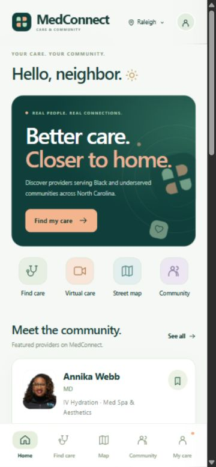
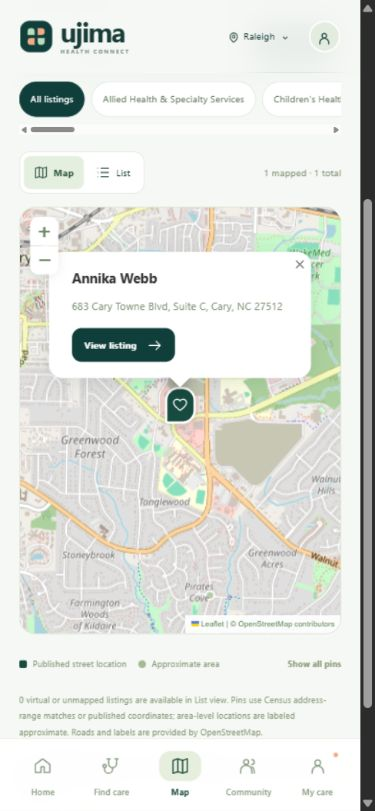

# MedConnect — real North Carolina directory

Live website: [medconnectnc.vercel.app](https://medconnectnc.vercel.app). The public app uses Vercel's free Hobby hosting.

[](https://github.com/jdbartlett929/MedConnect/actions/workflows/checks.yml)

MedConnect is a phone-first installable web app that contains a dated import of all 787 public provider listings from [Ujima Health Connect](https://ujimahealthconnect.com/), with reuse permission confirmed by the project owner. It preserves real names, credentials, practices, published photos, addresses, contact links, specialty fields, and source URLs. All 16 category memberships are included.

## Collaborate

Fork this repository, create a branch, and open a pull request. Read [CONTRIBUTING.md](CONTRIBUTING.md) for the workflow, data conventions, and review checks. Issues are open for bugs and feature suggestions.

```sh
git clone https://github.com/jdbartlett929/MedConnect.git
cd MedConnect
python -m http.server 4173 --directory dist
```

Open <http://localhost:4173>. On Windows, `py` can be used instead of `python`. To run checks, install Node.js 22 or newer and run `npm test`; no dependency installation, API keys, or build step is required.

## Preview

| Phone home | Real street map |
| --- | --- |
|  |  |

## Project structure

- `dist/index.html`, `dist/app.js`, `dist/styles.css`: editable app source.
- `dist/directory.json` and `dist/directory.js`: directory export and browser data; keep them consistent.
- `dist/geography.js`: North Carolina city and ZIP search data.
- `dist/sw.js`, `dist/manifest.webmanifest`, `dist/icons/`: installation and offline shell.
- `dist/vendor/`, `dist/sources.json`, `NOTICE.md`: libraries, attribution, and data provenance.
- `validate.mjs`: dependency-free behavior and directory checks.
- `.github/workflows/checks.yml`: checks on pushes and pull requests.

## What works

- Search by name, practice, specialty, city, ZIP, and published fields; combine categories, specialty, region, language, insurance text, coverage status, virtual visits, photos, Verified status, radius, and A–Z filters.
- Search 1,081 North Carolina postal places. Distance is straight-line from an approximate city or ZIP center.
- Real Leaflet / OpenStreetMap roads, street labels, and clustered listing pins, plus a list alternative.
- 500 street addresses matched through the US Census geocoder. 21 source pins moved more than 10 miles after address matching. Implausible remaining source coordinates were withheld or changed to labeled approximate city centers.
- Published office phone and email links, real practice websites, directions, and original Ujima profiles. These contacts are not contacted automatically.
- Saved listings, device-local preferences, personal calendar notes, and ICS calendar downloads.
- Official Ujima newsletter, social, contact, provider submission, and plan links; real NC 211 community-resource link.
- Home Screen installation metadata, app icons, cached directory shell, keyboard navigation, larger text, and responsive phone / desktop layouts.

## Scope and data accuracy

This is a working directory and personal organizer. It is not connected to provider scheduling or insurance systems. It does not book appointments, confirm benefits, supply live wait times, or simulate messages from real providers. Users arrange care through the actual provider contacts / websites. Personal calendar notes are explicitly not booking confirmations.

The public website does not publish all fields for every listing. Missing information remains unconfirmed; no provider genders, races, languages, insurance plans, appointment slots, or substitute portraits are invented. Directory Verified badges retain their source meaning, not insurance verification.

The import is dated 2026-11-13. This is not an automatic live feed. Every record links to its original listing for current information. Street matches do not verify an office is still occupied or identify a building entrance. 170 published source images / logos are linked; other listings use initials.

## Privacy and storage

The source directory data is public. Nicknames, filters, saved listings, and calendar notes are stored only in this browser under medconnect-directory-v1 (with automatic migration from the earlier Ujima app key). They do not sync across devices. Earlier prototype data is left untouched in its prior storage keys. No medical record system or patient database is created. External map tiles and source photographs are requested only as displayed. The service worker never prefetches or caches map tiles.

## Run and verify

The Vercel configuration serves the existing `dist/` directory without a build or dependency installation. To publish an update from the linked project:

    vercel deploy --prod --project medconnect --scope jdbartlett929s-projects

Serve dist through a static HTTP server:

    python -m http.server 4173 --directory dist

Open http://localhost:4173. Production installation uses HTTPS. On iPhone use Safari > Share > Add to Home Screen. On Android use Chrome > menu > Install app / Add to Home screen. The production deployment is managed separately; commits here do not automatically change the hosted app.

Run the dependency-free checks:

    node validate.mjs

## Data and attribution

dist/directory.json is the complete factual directory export. dist/sources.json lists source / license information. Leaflet and markercluster licenses are retained under dist/vendor. Roads: © OpenStreetMap contributors. City and ZIP data: GeoNames, CC BY 4.0. Address matching: US Census Bureau.

See [NOTICE.md](NOTICE.md) for content rights and third-party licenses. Public access supports collaboration through forks and pull requests; it does not grant a separate blanket license for provider photos, branding, or directory content.

## Updating the directory

No approved API or export was available. The current data was collected from authorized public listing and category pages, without access to administrative endpoints. A future import should repeat the public-source and coordinate-quality checks before updating directory.js / directory.json and incrementing the app / service-worker cache version. Provider scheduling requires a separate approved integration; do not replace contact links with simulated slots.
